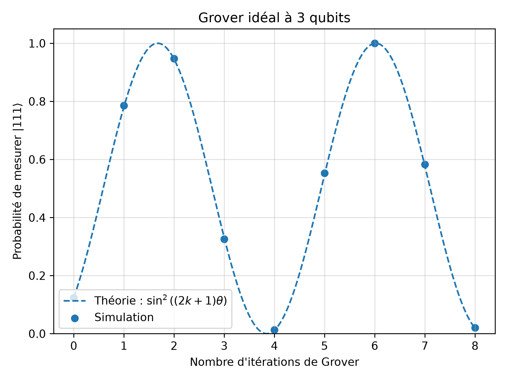
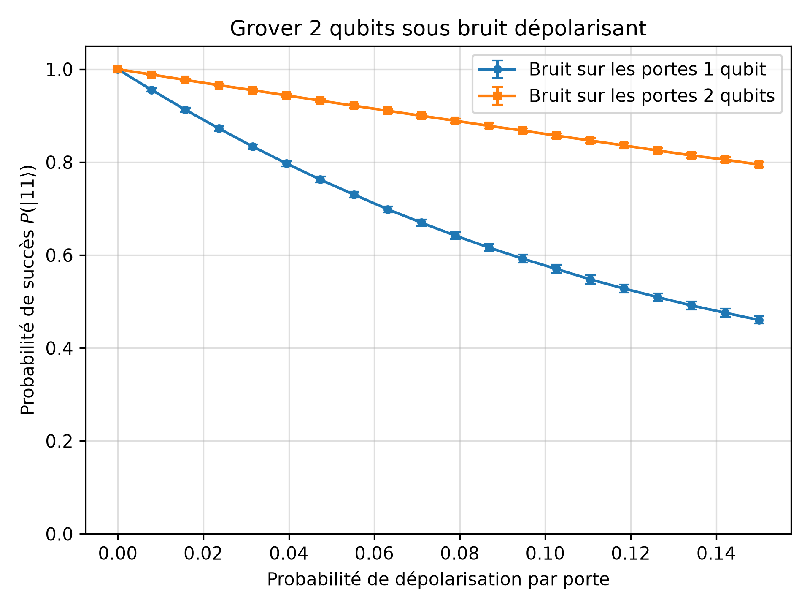
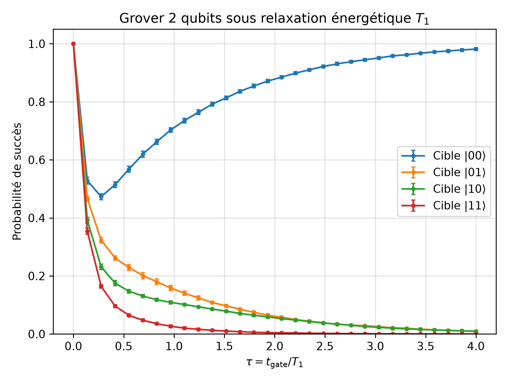
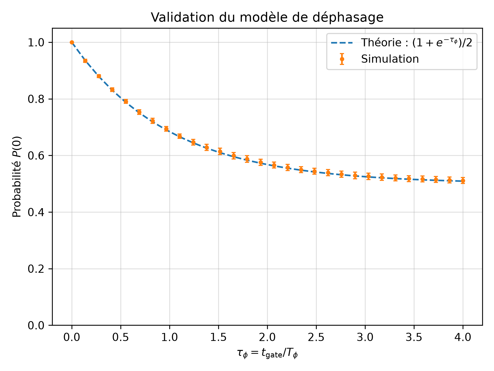
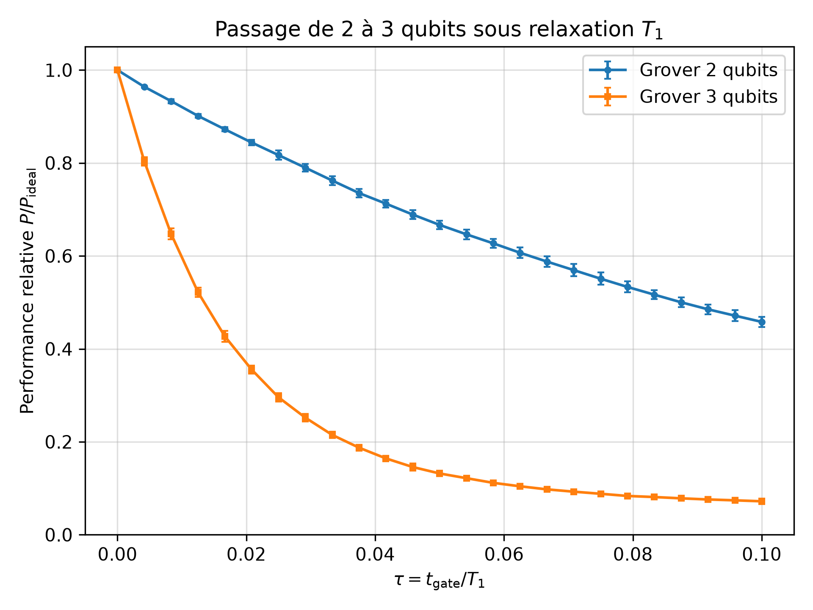
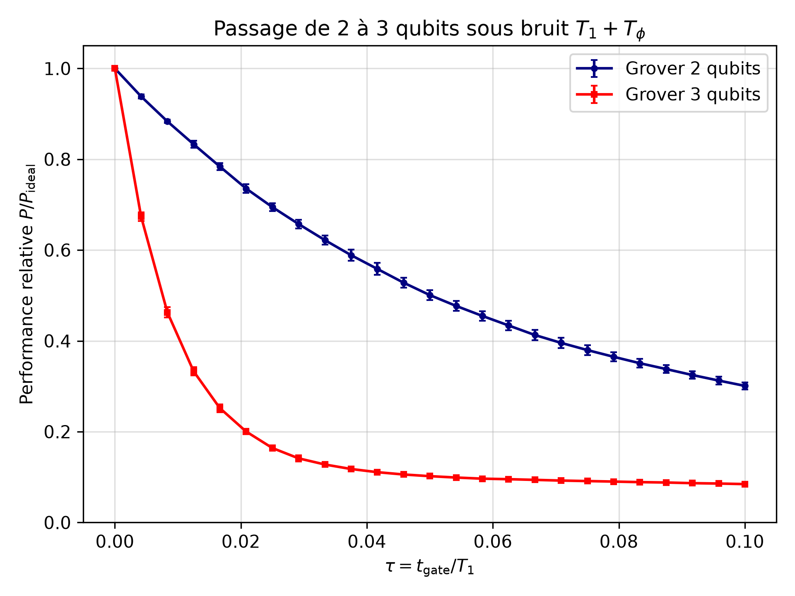

# Grover's algorithm under quantum noise

I started this project as an introduction to quantum computing with Qiskit. Rather than only implementing a quantum algorithm, I wanted to understand what actually happens to it when the qubits are no longer ideal.

I chose Grover's search algorithm because it provides a relatively simple setting in which the role of superposition and interference can be studied explicitly. I first implemented the algorithm on two qubits and checked its ideal behaviour, before progressively introducing different noise models.

The project eventually led me to a question that became the main focus of the study: how does the effect of noise evolve when the circuit becomes more complex?

To explore this, I studied depolarizing noise, energy relaxation and dephasing, then compared implementations of Grover's algorithm using two and three qubits.

## Ideal Grover algorithm

For a search space of \(N\) states, Grover's algorithm repeatedly applies an oracle and a diffusion operator to amplify the amplitude of the state we are looking for.

If

\[
\sin(\theta)=\frac{1}{\sqrt{N}},
\]

the ideal probability of measuring the marked state after \(k\) Grover iterations is

\[
P_k=\sin^2((2k+1)\theta).
\]

I first reproduced this behaviour numerically with Qiskit.

For two qubits (\(N=4\)), a single Grover iteration is enough to reach the marked state with probability 1.

I then moved to three qubits (\(N=8\)). In this case the first maximum occurs after two iterations, with

\[
P_{\mathrm{success}}=\frac{121}{128}\approx94.5\%.
\]



The simulated probabilities follow the theoretical \(\sin^2\) evolution, which provided a first check of the implementation before introducing noise.

## Adding quantum noise

Once the ideal algorithm was working, I progressively introduced several noise models using Qiskit Aer.

I started with depolarizing noise as a simple way to study errors on one- and two-qubit gates. I then focused on two physically meaningful decoherence mechanisms: energy relaxation and pure dephasing.

### Depolarizing noise

The first noise model I studied was depolarizing noise. At this stage, my goal was mainly to understand how errors could be introduced into a Qiskit simulation and how errors acting on different types of gates affected the final result.

I compared two situations: depolarizing noise applied only to one-qubit gates, and the same error probability applied only to two-qubit gates.



One result initially seemed counter-intuitive: for the same error probability per gate, noise on the one-qubit gates had a larger effect on the success probability in this particular circuit.

The explanation comes from the circuit itself. The error probability of an individual gate is not enough to predict the final performance: the number of times that gate type appears also matters. Since the circuit contains many more one-qubit gates than two-qubit gates, the one-qubit noise channel is applied more often.

This first experiment was useful because it showed me that studying quantum noise requires looking at both the noise model and the structure of the circuit. I then moved to more physically motivated models based on relaxation and dephasing.


## Energy relaxation
For energy relaxation, I used the amplitude damping channel with

\[
\gamma_1=1-e^{-t_{\mathrm{gate}}/T_1}.
\]

This part gave an interesting result when comparing different marked states. Since relaxation drives \(|1\rangle\) towards \(|0\rangle\), the four possible targets are not affected in the same way.



In particular, the probability of measuring \(|00\rangle\) eventually increases again at strong noise. This should of course not be interpreted as Grover becoming more efficient: the noise itself is simply driving the system towards \(|00\rangle\).


## Dephasing
I then studied pure dephasing, characterized by \(T_\phi\). Unlike relaxation, it does not preferentially drive the system towards \(|0\rangle\). Instead, it destroys the off-diagonal terms of the density matrix and therefore progressively removes the coherence required for interference.

I first checked the implementation on a simple one-qubit interference experiment:



I then applied the same model to Grover's algorithm. As coherence disappears, the amplitude-amplification mechanism progressively stops working.

## From 2 to 3 qubits

The part I found most interesting was comparing the two- and three-qubit implementations under the same noise assumptions.

Moving from two to three qubits may sound like a small change, but the resulting circuit is substantially more complex. In particular, the three-qubit oracle requires a controlled-controlled phase operation, which I implemented using a CCX gate and then decomposed into elementary gates.

With the gate basis used in this project, I obtained:

| | 2 qubits | 3 qubits |
|---|---:|---:|
| Quantum gates | 16 | 95 |
| CX gates | 2 | 24 |
| Circuit depth | 12 | 58 |

To avoid comparing two algorithms with different ideal success probabilities, I used the normalized quantity

\[
R(\tau)=\frac{P_{\mathrm{noisy}}(\tau)}
{P_{\mathrm{ideal}}}.
\]

Under energy relaxation, the difference between the two circuits becomes clear:



I finally combined relaxation and pure dephasing, using \(T_\phi=T_1\), which corresponds to

\[
T_2=\frac{2}{3}T_1.
\]



The three-qubit implementation loses its ideal performance much faster.

I do not interpret this as saying that "three qubits are intrinsically much noisier than two". In this implementation, adding a qubit also makes the circuit much deeper and increases the number of two-qubit gates from 2 to 24. The quantum state is therefore exposed to the noise channels many more times before the final measurement.

This was probably the main lesson I took from the project: **the effect of noise cannot be separated from the complexity of the circuit implementing the algorithm.**

## Repository

The code is organized into two main parts:

```text
src/
├── grover.py
└── noise_models.py

experiments/
├── 01_ideal_grover.py
├── 02_depolarizing_noise.py
├── 03_amplitude_damping.py
├── 04_dephasing.py
├── 05_combined_noise.py
└── 06_scaling_2q_3q.py
```

`src/` contains the Grover circuits and noise models, while `experiments/` contains the simulations used to produce the figures.

A more detailed discussion of the theory and results is available in the report in `report/`.

## Running the project

The project was developed with Python 3.12 and Qiskit.

Create a virtual environment and install the dependencies with:

```bash
python3 -m venv .venv
source .venv/bin/activate
python -m pip install -r requirements.txt
```

Experiments can then be run from the root of the repository. For example:

```bash
python -m experiments.06_scaling_2q_3q
```

The figures are automatically saved in the `figures/` directory.

## Limitations

This remains a small-scale simulation project rather than a model of a specific quantum processor. I assumed independent noise channels and simplified effective gate durations, and I did not include hardware-specific connectivity, calibration data or readout errors.

A natural continuation would be to replace these simplified noise models with calibration data from a real device and investigate how transpilation and hardware topology affect the conclusions.


## Sources 
I exclusively used the Internet for this project, websites likes Wikipedia or others which explain Grover's algorithm ,quantuum physics, the Qiskit library, as well as ChatGPT for the organisation of the code.